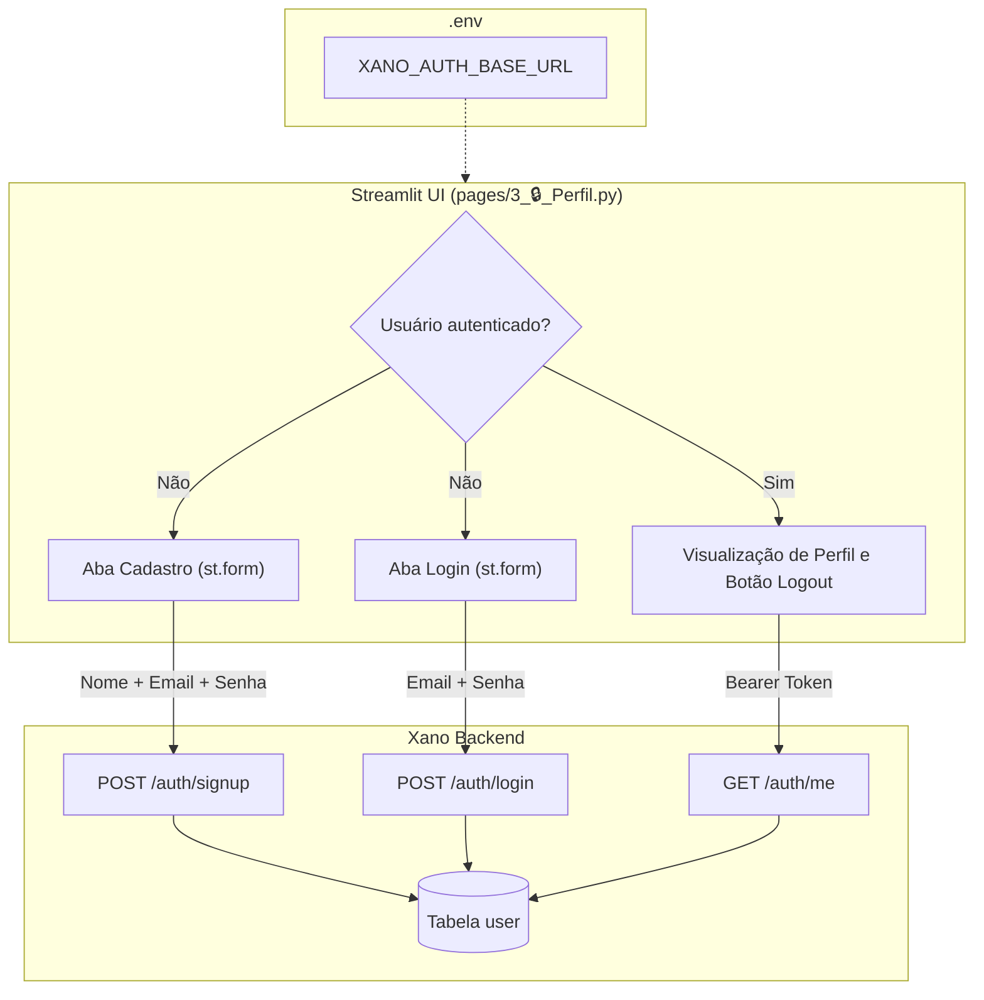

# Design Técnico: Autenticação e Perfil do Usuário

## Arquitetura da Solução



## Configuração de Ambiente (.env)

O arquivo `.env` na raiz do projeto armazenará a URL base da API Authentication do Xano:
```env
XANO_AUTH_BASE_URL=https://x8ki-letl-twmt.n7.xano.io/api:6Tn0YgRn
```
*(Nota: Baseada na instância `x8ki-letl-twmt` e no grupo canônico `6Tn0YgRn` registrado em `apis/authentication/api_group.xs`).*

## Gerenciamento de Estado no Streamlit (`st.session_state`)

- `st.session_state["auth_token"]`: String com o token JWT retornado pelo login/cadastro (ou `None` se deslogado).
- `st.session_state["user"]`: Dicionário com os dados do perfil do usuário obtidos via `auth/me`.
- `st.session_state["authenticated"]`: Booleano indicando o status atual da sessão.

## Módulo de Serviços / Chamadas HTTP (`requests`)

Serão encapsuladas 3 funções principais para comunicação com o Xano:
1. `login(email: str, password: str) -> tuple[bool, dict | str]`
   - Executa `POST {XANO_AUTH_BASE_URL}/auth/login`.
   - Retorna o payload com `authToken` em caso de sucesso ou a mensagem de erro.
2. `signup(name: str, email: str, password: str) -> tuple[bool, dict | str]`
   - Executa `POST {XANO_AUTH_BASE_URL}/auth/signup`.
   - Retorna o payload com `authToken` e persiste na tabela `user`.
3. `get_me(auth_token: str) -> tuple[bool, dict | str]`
   - Executa `GET {XANO_AUTH_BASE_URL}/auth/me` enviando cabeçalho `Authorization: Bearer <auth_token>`.
   - Retorna os dados cadastrais do usuário (`id`, `name`, `email`, `role`, `account_id`, `created_at`).

## Estrutura da Interface em `pages/3_🔒_Perfil.py`

- **Título e Ícone**: `st.set_page_config(page_title="Perfil e Autenticação", page_icon="🔒", layout="wide")`.
- **Fluxo Não Autenticado**:
  - `st.tabs(["🔑 Acessar Conta", "📝 Novo Cadastro"])`
  - Formulários (`st.form`) com campos devidamente tipados (`type="password"` para senhas).
  - Feedback visual imediato com `st.error` ou `st.success` e indicador de carregamento com `st.spinner`.
- **Fluxo Autenticado**:
  - Mensagem de boas-vindas: `Olá, {user['name']}!`
  - Exibição de cards informativos com métricas (E-mail, Função/Role, ID da Conta, Data de Criação formatada).
  - Ação de Logout: `st.button("🚪 Sair da Conta")` que limpa as chaves no `st.session_state` e chama `st.rerun()`.

