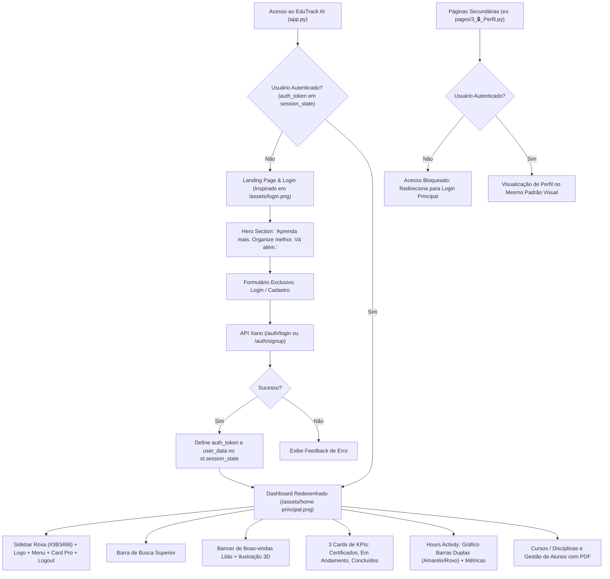

# Design Técnico: Reformulação do Design e Centralização da Autenticação

## Arquitetura Visual e Fluxos de Usuário

## Paleta de Cores e Guia de Estilo

1. **Sidebar e Identidade Visual (Inspirado em `/assets/home principal.png`)**:
   - Fundo da Sidebar: `#3B3486` (ou `#352E7E`)
   - Item de Menu Ativo: `#4E44B4` com cantos arredondados (`border-radius: 10px`) e texto branco
   - Card Pro na Sidebar: Gradiente roxo vibrante `#4E44B4` a `#6C5CE7` com ilustração de foguete/personagem 3D
   - Cor de Fundo da Aplicação: `#F8F9FD`
2. **Banner de Boas-Vindas**:
   - Fundo: Gradiente linear suave `linear-gradient(135deg, #F3E8FF 0%, #EDE9FE 100%)`
   - Título: `#4A3E8D` (roxo profundo elegante)
   - Tipografia de Suporte: `#6B7280`
3. **Gráficos e Indicadores ("Hours Activity")**:
   - Barras Amarelas (Teoria / Aulas): `#F6C768`
   - Barras Roxas (Prática / Projetos): `#6C5CE7`
   - Pill Badge Positivo: Fundo `#DEF7EC`, Texto `#03543F`
   - Pill Badge Negativo: Fundo `#FDE8E8`, Texto `#9B1C1C`
4. **Landing Page de Login (Inspirado em `/assets/login.png`)**:
   - Estética minimalista preto e branco estilo Notion
   - Fundo limpo `#FFFFFF`
   - Tipografia forte em `sans-serif` moderna (`Inter`, `-apple-system`)
   - Badge destacado: `● Inteligência Acadêmica` em verde suave
   - Cartões com sombras leves e bordas de 1px sutis (`#E5E7EB`)

## Componentização e Módulos

- `utils/theme.py`: Módulo central que encapsula o CSS global, temas do Streamlit, renderização do cabeçalho da sidebar, banners e cards, garantindo uniformidade entre todas as páginas.
- `app.py`:
  - Lógica condicional: Se não autenticado, renderiza a Landing/Login page baseada em `login.png`.
  - Se autenticado, renderiza o dashboard completo baseado em `home principal.png`.
- `pages/3_🔒_Perfil.py`:
  - Removido formulário de login/cadastro.
  - Bloqueio automático para requisições deslogadas.
  - Estilização harmonizada com o tema Smart Education.
