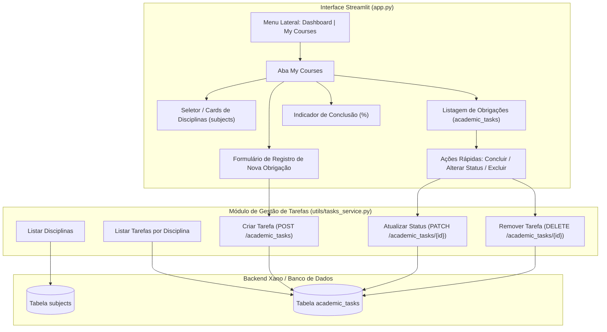

# Design Técnico: Registro e Gestão de Obrigações Acadêmicas

## Arquitetura da Solução

## Esquema de Dados (`academic_tasks`)

O esquema atende exatamente à especificação exigida:
| Campo | Tipo | Descrição |
|---|---|---|
| `id` | `int` | Identificador único da tarefa |
| `title` | `text` | Título da obrigação acadêmica (ex: "Lição 3 - Grid Layout") |
| `description` | `text` | Descrição detalhada da atividade |
| `due_date` | `date` | Data de entrega (formato AAAA-MM-DD) |
| `status` | `text` | Status da tarefa: `Pendente`, `Em Andamento`, `Concluído` |
| `subject_id` | `int` (FK) | Chave estrangeira referenciando a tabela `subjects` |
| `user_id` | `int` (FK) | Vínculo com o usuário autenticado |

## Componentes Visuais em "My Courses"
1. **Cards das Matérias com Barra de Progresso**:
   - Cada disciplina exibe seu docente, carga horária, quantidade de tarefas cadastradas e barra de progresso baseada na fórmula:
     $$\text{Progresso} = \left(\frac{\text{Tarefas Concluídas}}{\text{Total de Tarefas}}\right) \times 100$$
2. **Painel de Registro (Formulário)**:
   - Formulário `st.form("form_nova_tarefa")` estilizado com botões modernos, campos para título, descrição, seleção da matéria, data limite e status inicial.
3. **Gerenciador de Tarefas**:
   - Abas ou visualização em cartões das tarefas da disciplina selecionada.
   - Badges coloridos por status:
     - `Concluído`: Verde (`badge-pill-success`)
     - `Em Andamento`: Amarelo (`badge-pill-warning`)
     - `Pendente`: Roxo / Neutro
   - Botão rápido para marcar como concluído (`✓ Concluir`) e botão para remover (`🗑️ Excluir`).
